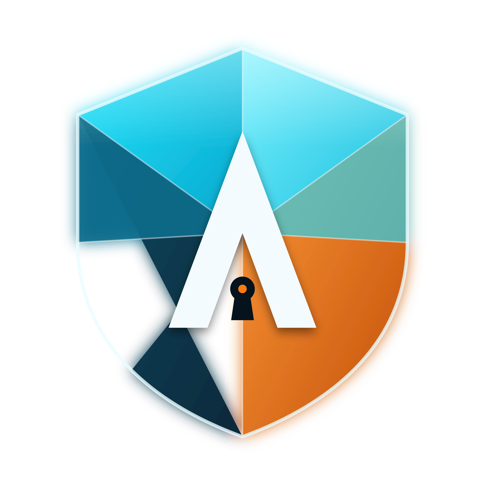

<p align="center">
  
</p>

# Aeternum Security OS

**Resilient • Defensive • Hardened**

This is the top level of the Aeternum Security OS source repository.

Aeternum Security OS is a live and installable operating system built on
FreeBSD 15.1 (amd64), for security work: penetration testing, defense,
forensics and hardening. It ships an XFCE desktop, the `pf` firewall enabled
by default and a curated set of security tools.

**Version 1.0, first release.** A bootable ISO is built automatically by
GitHub Actions. Before installing it, try it in a virtual machine or on a
test PC.

[Website and download](https://josephleschajoffical.github.io/AETERNUM/) ·
[Italiano](README.it.md) · [Roadmap](ROADMAP.md) · [Changelog](CHANGELOG.md) ·
[License](LICENSE)

## Source Roadmap

| Path | Description |
| --- | --- |
| `.github` | CI workflows, issue and pull request templates. |
| `assets` | Branding: logo, wordmark, wallpaper, icon, boot animation. |
| `docs` | Installation, build and architecture documentation. |
| `kernel` | Kernel configuration (`AETERNUM`), see [`docs/HARDENING.md`](docs/HARDENING.md). |
| `overlay` | Configuration files and scripts installed into the image, laid out like `/`. |
| `packages` | Package lists installed into the image, one name per line. |
| `release` | Release procedure and release notes. |
| `scripts` | Image build script. |
| `tests` | Repository checks, run with `sh tests/check.sh`. |
| `tools` | Helper scripts, e.g. `verify-iso.sh` to check an ISO against its `.sha256`. |
| `CHANGELOG.md` | Changes per version. |
| `CODE_OF_CONDUCT.md` | Rules for taking part in the project. |
| `CONTRIBUTING.md` | Contribution guidelines. |
| `LICENSE` | BSD 2-Clause License. |
| `MAINTAINERS` | Who looks after what. |
| `NOTICE.md` | Third-party software, trademarks and branding. |
| `ROADMAP.md` | Planned work, by phase. |
| `SECURITY.md` | Supported versions and private vulnerability reporting. |
| `VERSION` | Current version. |
| `index.html` | Source of the project website. |

## Trying the image

1. Download the ISO archive from the website; extract the `.iso` and the `.sha256` file and verify the checksum.
2. Write the image to a USB drive of at least 8 GB with [Rufus](https://rufus.ie) in **DD Image** mode. The drive is erased.
3. Boot in **UEFI** mode (disable Secure Boot if it does not start).
4. The live session logs in automatically. Default credentials: `admin` / `admin`.

The experimental disk installer (UEFI only) **erases the selected disk**. Try
it on a virtual machine or a test machine first. See
[`docs/INSTALL.md`](docs/INSTALL.md).

## Building

The ISO is built inside a FreeBSD 15.1 virtual machine by the
[`build-iso`](.github/workflows/build-os.yml) workflow. On a FreeBSD 15.1 host,
as root:

```sh
./scripts/build-aeternum-iso.sh
```

See [`docs/BUILD.md`](docs/BUILD.md) and [`docs/ARCHITECTURE.md`](docs/ARCHITECTURE.md).

## Responsible use

The included tools can cause harm if misused. Test only systems you own or
have explicit written permission to test. The authors accept no responsibility
for misuse.

## Author

Aeternum Security OS was created by Zef Lleshaj, developer, systems administrator and IT technician,
qualified in Cybersecurity.
Developed in Rome, Italy.

## License

Original code and documentation are licensed under the BSD 2-Clause
License. FreeBSD and the packages from its ports collection keep their own
licenses; see [NOTICE.md](NOTICE.md). Aeternum Security OS is an independent
project, not affiliated with the FreeBSD Project or the FreeBSD Foundation.
